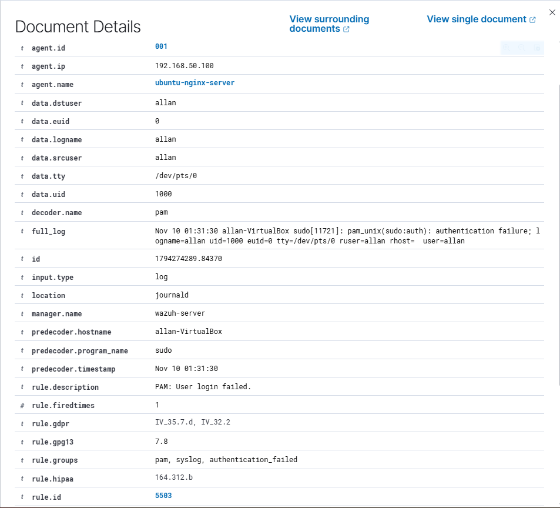
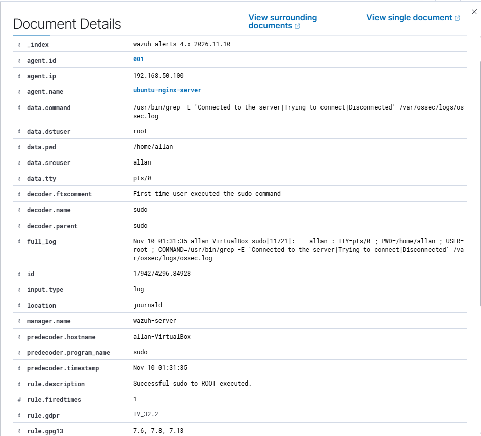
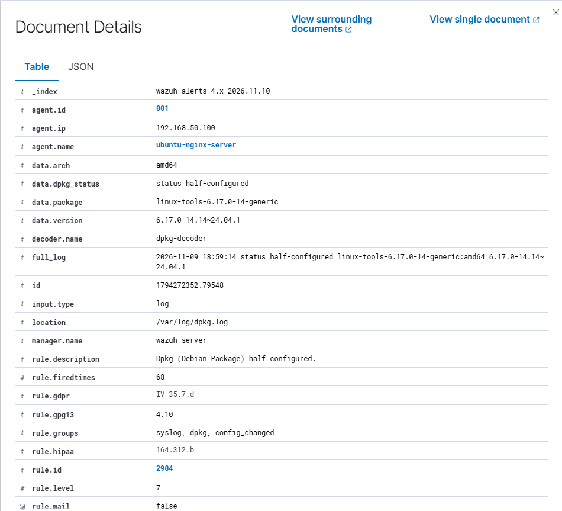
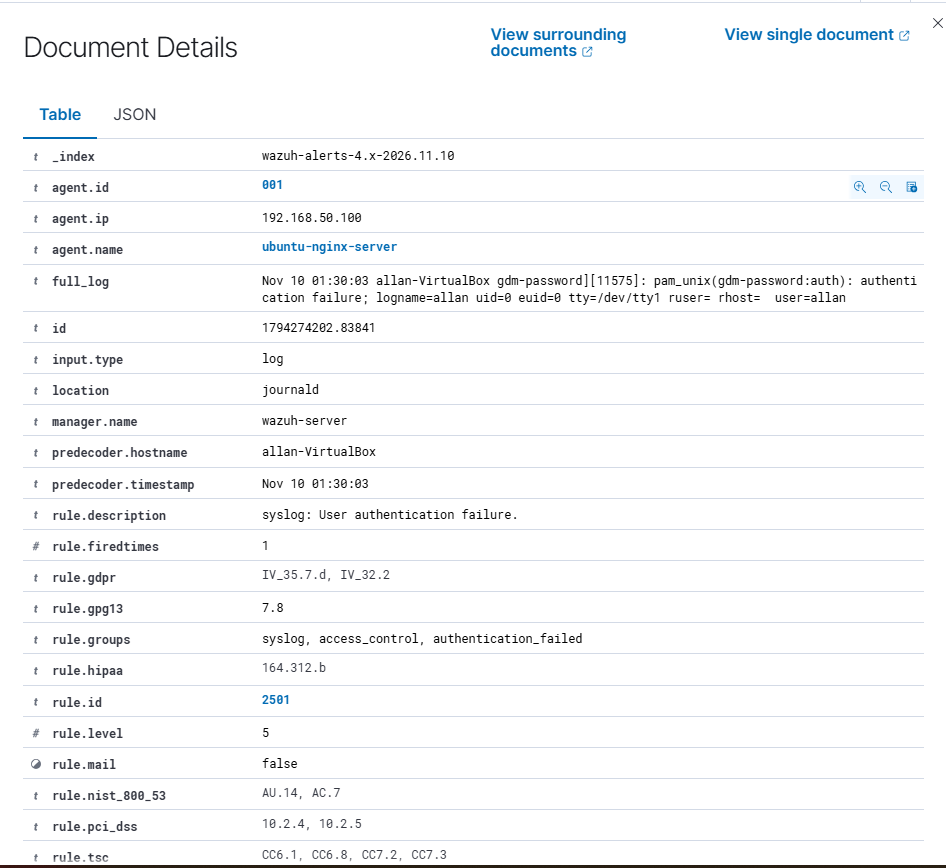
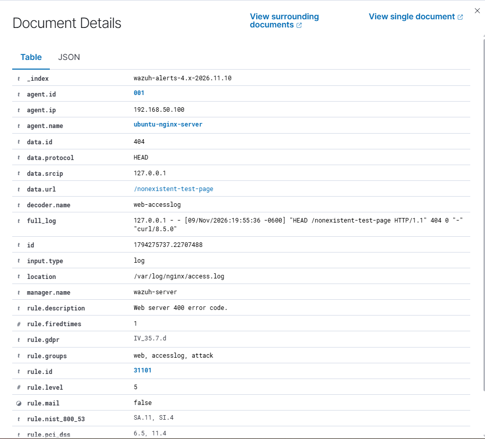
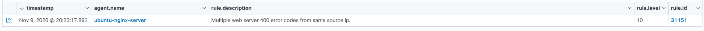
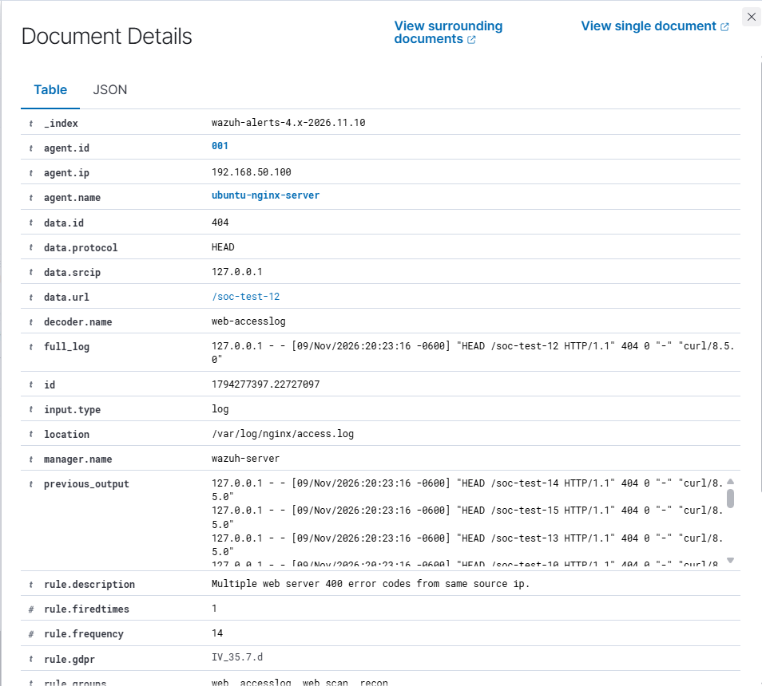

# wazuh-siem-part-3-soc-investigations
SOC investigations using Wazuh SIEM: Linux authentication, package alerts, Nginx HTTP detection, and event correlation.
# Wazuh SIEM Homelab — Part 3: SOC Alert Investigation & Event Correlation

## Project Overview

This project demonstrates hands-on Security Operations Center (SOC) investigation using Wazuh SIEM, Ubuntu Linux, and Nginx.

Building on the previous Wazuh homelab exercises, Part 3 focuses on investigating authentication failures, package configuration alerts, HTTP access logs, and correlation-based security detections.

The objective was to understand how security alerts are generated, validate findings against original system logs, and distinguish benign administrative activity from potentially suspicious behavior.

## Lab Environment

| Component | Configuration |
|---|---|
| Virtualization | Oracle VirtualBox |
| SIEM | Wazuh 4.14.9 |
| Firewall | pfSense 2.9.0 |
| Monitored endpoint | Ubuntu Linux |
| Ubuntu agent | `ubuntu-nginx-server` |
| Ubuntu IP | `192.168.50.100` |
| Wazuh Manager IP | `192.168.50.102` |
| Log sources | Journald, authentication logs, dpkg logs, Nginx access logs |
| Web server | Nginx |

All investigations were conducted in an isolated, authorized homelab environment.

---

## Investigation 1 — Linux Authentication Failure

### Objective

Investigate a failed sudo authentication alert and determine whether it represented suspicious activity.

### Detection

Wazuh generated Rule **5503**, Level **5**:

`PAM: User login failed.`



### Findings

- Username: `allan`
- Authentication service: `sudo`
- Terminal: `/dev/pts/0`
- Detection rule: `5503`
- Severity: Level 5

A subsequent alert showed a successful sudo command approximately five seconds later.

Wazuh Rule **5402** recorded:

`Successful sudo to ROOT executed.`



### Analysis

The failed authentication and subsequent successful sudo execution involved the same user and terminal.

The successful command inspected Wazuh agent connection logs, matching authorized troubleshooting activity.

### SOC Conclusion

**Classification:** Benign administrative activity.

The evidence is consistent with an unsuccessful authentication attempt followed by a successful retry. No evidence of unauthorized access was identified.

---

## Investigation 2 — Linux Package Configuration Alert

### Objective

Investigate a package configuration warning detected by Wazuh.

### Detection

- Rule ID: `2904`
- Severity: Level 7
- Description: `Dpkg (Debian Package) half configured.`
- Package: `linux-tools-6.17.0-14-generic`



### Analysis

The alert indicated that the package entered a half-configured state during package management activity.

Additional investigation included checking the current package state and running:

```bash
sudo dpkg --audit
```

The audit returned no output, indicating no package problems reported by that check at the time.

The historical Wazuh alert alone did not establish that the package remained broken or caused the Ubuntu graphical desktop issues.

### SOC Conclusion

**Classification:** Historical package configuration event.

No unresolved package configuration issue was confirmed during the investigation.

---

## Investigation 3 — Ubuntu Graphical Login Failure

### Objective

Investigate an authentication failure associated with Ubuntu's graphical login manager.

### Detection

- Rule ID: `2501`
- Severity: Level 5
- Description: `syslog: User authentication failure.`
- Authentication service: `gdm-password`
- Username: `allan`
- Terminal: `/dev/tty1`



### Analysis

The alert originated from PAM authentication processing during a graphical login attempt.

Local authentication logs confirmed the failure.

The available evidence did not establish the precise cause of the authentication failure or conclusively correlate it with a subsequent successful graphical login.

### SOC Conclusion

**Classification:** Authentication failure — cause inconclusive.

No evidence of an external attack was identified. The event occurred during local homelab troubleshooting.

---

## Investigation 4 — Nginx HTTP Detection & Event Correlation

### Objective

Verify Nginx access-log collection in Wazuh and test how the SIEM detects individual HTTP errors versus repeated errors from the same source IP.

### Phase A — HTTP Access Log Collection

Nginx was configured to record HTTP requests in:

```text
/var/log/nginx/access.log
```

The Wazuh agent configuration included:

```xml
<localfile>
  <log_format>apache</log_format>
  <location>/var/log/nginx/access.log</location>
</localfile>
```

A normal HTTP request returned `200 OK`.

A request for a nonexistent resource returned `404 Not Found`.

Example test:

```bash
curl -I http://127.0.0.1/nonexistent-test-page
```

### Phase B — HTTP 404 Detection

Wazuh generated:

- Rule ID: `31101`
- Severity: Level 5
- Description: `Web server 400 error code.`
- Source IP: `127.0.0.1`
- HTTP method: `HEAD`
- Requested URL: `/nonexistent-test-page`
- HTTP status: `404`



### Detection Logic

The built-in rule uses the following conditions:

```xml
<rule id="31101" level="5">
  <if_sid>31100</if_sid>
  <id>^4\d\d</id>
  <description>Web server 400 error code.</description>
</rule>
```

The regular expression matches HTTP 4xx response codes.

The parent Rule `31100` groups web access-log events, while Rule `31101` identifies HTTP client-error responses.

### Phase C — Repeated HTTP Error Correlation

The Wazuh ruleset also contained Rule `31151`:

```xml
<rule id="31151" level="10" frequency="14" timeframe="90">
  <if_matched_sid>31101</if_matched_sid>
  <same_source_ip />
</rule>
```

This rule correlates repeated HTTP 4xx detections from the same source IP within a 90-second window.

To validate the correlation, controlled requests were generated against the local Nginx server:

```bash
for i in {1..15}; do
  curl -s -o /dev/null -I http://127.0.0.1/soc-test-$i
done
```

### Result — Level 10 Detection

Wazuh successfully generated Rule **31151**, Level **10**:

`Multiple web server 400 error codes from same source ip.`



The alert details confirmed:

- Agent: `ubuntu-nginx-server`
- Source IP: `127.0.0.1`
- HTTP response: `404`
- Correlation rule: `31151`
- Rule frequency: `14`
- Rule fired times: `1`
- Detection groups: `web`, `accesslog`, `web_scan`, `recon`

The `previous_output` field contained supporting HTTP request entries associated with the correlated detection.



### SOC Conclusion

**Classification:** Benign — authorized security testing.

Wazuh correctly detected both individual HTTP errors and a pattern of repeated HTTP errors.

Although the correlation rule belongs to web-scanning and reconnaissance detection groups, the requests were intentionally generated within the homelab.

**Remediation:** None required.

---

## Investigation 5 — Nginx Error Log Review

The Nginx error log was inspected:

```bash
sudo tail -n 10 /var/log/nginx/error.log
```

The current log file existed but was empty.

**Finding:** No Nginx error-log events were available for further investigation.

This was not treated as a configuration failure.

---

## Investigation 6 — Wazuh Agent Health

### Objective

Verify that the Ubuntu Wazuh agent was operational and communicating with the manager.

The following components were confirmed running:

- `wazuh-modulesd`
- `wazuh-logcollector`
- `wazuh-syscheckd`
- `wazuh-agentd`
- `wazuh-execd`

Agent logs also confirmed a successful connection to:

`192.168.50.102:1514/TCP`

Additional log entries showed successful security configuration assessment and system inventory evaluations.

**Conclusion:** Agent services were operational, and the successful Nginx detections demonstrated functioning log delivery during the investigation.

---

## Investigation 7 — Authentication Log Correlation

Ubuntu authentication logs were examined using:

```bash
sudo tail -n 10 /var/log/auth.log
```

The investigation correlated the earlier failed sudo authentication with a subsequent successful privileged command.

The timeline showed:

1. Failed sudo authentication at 19:31:30.
2. Successful sudo command at 19:31:35.
3. Privileged session opened and closed normally.

**Conclusion:** Activity was consistent with authorized administrative troubleshooting.

---

## Investigation 8 — Nginx Service Activity

Nginx service activity was reviewed through systemd journal logs.

The service successfully started, and no unexpected restart or failure appeared in the selected journal output.

**Conclusion:** No suspicious Nginx service activity was identified.

---

## Investigation 9 — Apache2 Port Conflict

### Objective

Identify why Apache2 was marked as failed while Nginx remained operational.

Apache2 reported:

```text
Address already in use
no listening sockets available, shutting down
```

A listening-socket inspection confirmed that Nginx occupied TCP port 80 on IPv4 and IPv6 interfaces.

```bash
sudo ss -ltnp '( sport = :80 )'
```

### Root Cause

Apache2 attempted to bind to a port already occupied by Nginx.

### SOC Conclusion

**Classification:** Operational service conflict, not a security incident.

Nginx was the intended web server, so no immediate configuration change was required.

---

## Key Skills Demonstrated

- SIEM alert investigation and triage
- Linux authentication log analysis
- PAM and sudo event correlation
- Wazuh rule inspection and interpretation
- HTTP access-log analysis
- Nginx log ingestion verification
- Rule-based detection and event correlation
- Severity assessment and false-positive classification
- Linux service troubleshooting
- TCP listening-port investigation
- Evidence-based incident documentation

## Final Project Summary

Wazuh Part 3 demonstrated how to investigate endpoint and web-server events using a SIEM.

The most significant result was successfully generating a **Level 10 Wazuh correlation alert** from repeated HTTP 404 responses and validating its source, detection logic, and supporting log evidence.

The investigations also reinforced the importance of distinguishing detection severity from actual malicious intent.

All activity was performed in an authorized homelab environment for educational purposes.
